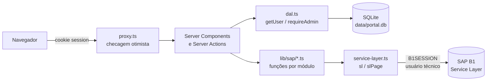

# Arquitetura

## Visão geral



- **Sem API intermediária.** Páginas (Server Components) e Server Actions chamam as funções de `src/lib/sap/` direto no servidor. Nenhum dado do SAP é buscado pelo navegador.
- **Dois "logins" diferentes:**
  - **Usuário do portal** — e-mail/senha no SQLite. Define quem entra e se é `admin` ou `user`.
  - **Usuário técnico do SAP** — `SAP_USER`/`SAP_PASSWORD` no `.env`. Todas as chamadas ao Service Layer usam essa sessão, compartilhada no processo.

## Estrutura de pastas

```
src/
├── proxy.ts                         # redireciona quem não tem sessão para /login
├── app/
│   ├── layout.tsx                   # <html data-theme> (tema do cliente), fontes
│   ├── globals.css                  # tokens → classes Tailwind; btn-*, input, card
│   ├── (auth)/login/                # tela pública de login
│   └── (portal)/                    # tudo que exige login
│       ├── layout.tsx               # sidebar + header + <Suspense>
│       ├── error.tsx                # erro genérico das páginas
│       ├── page.tsx                 # dashboard
│       ├── itens/ parceiros/ vendas/[tipo]/ financeiro/ admin/usuarios/
│       │   ├── page.tsx             # lista
│       │   ├── [id]/page.tsx        # detalhe
│       │   ├── novo/page.tsx        # criação
│       │   ├── actions.ts           # Server Actions ('use server')
│       │   └── *-form.tsx           # form client (useActionState)
├── components/
│   ├── menu.ts                      # definição única do menu
│   ├── sidebar.tsx                  # sidebar responsiva (client)
│   ├── ui.tsx                       # PageHeader, DataTable, Pagination, SearchForm, Badge, DocStatus, Field, SelectField, Alert, Detail
│   ├── skeletons.tsx                # telas de carregamento (List/Detail/Form/Dashboard)
│   └── submit-button.tsx            # botão com spinner enquanto a action roda
├── lib/
│   ├── db.ts                        # SQLite, tabela users, hash scrypt, admin inicial
│   ├── users.ts                     # queries de usuário (sem auth check — uso interno)
│   ├── session.ts                   # cookie JWT (jose)
│   ├── dal.ts                       # getUser() / requireAdmin()
│   ├── auth-actions.ts              # login / logout
│   ├── service-layer.ts             # cliente único do SAP
│   ├── format.ts                    # moeda, data, número, params de lista
│   └── sap/                         # uma camada de dados por módulo
│       ├── items.ts
│       ├── business-partners.ts
│       ├── sales-documents.ts
│       └── finance.ts
└── styles/themes.css                # cores por cliente
scripts/
├── mock-sl.mjs                      # mock do Service Layer
└── e2e.mjs                          # testes ponta a ponta
```

## Fluxo de uma requisição

Exemplo: usuário abre `/vendas/pedidos?status=aberto`.

1. **`proxy.ts`** decifra o cookie `session`. Inválido/ausente → redirect `/login?next=/vendas/pedidos`. Não consulta banco (roda em toda rota, inclusive prefetch).
2. **`(portal)/layout.tsx`** renderiza o shell. Sidebar e menu do usuário leem a sessão dentro de `<Suspense>`. A página fica atrás do `loading.tsx` da rota: o skeleton aparece na hora e a página entra em streaming.
3. **`vendas/[tipo]/page.tsx`** valida `tipo` contra a config (`salesTypes`), lê `searchParams`, chama `listDocuments("pedidos", …)`.
4. **`lib/sap/sales-documents.ts`** monta o `$filter` (strings sempre por `odataString`) e chama `slPage("Orders", …)`.
5. **`service-layer.ts`** chama `getUser()` (DAL: confere sessão **e** se o usuário ainda existe/está ativo no SQLite), garante sessão SL e faz `GET /Orders?…` e `GET /Orders/$count?…` em paralelo.
6. Resultado volta como DTO enxuto e é renderizado com `DataTable` + `Pagination`.

Mutations seguem o mesmo caminho via Server Action: `getUser()` → zod → função de `lib/sap` → `redirect` (sucesso) ou `{ error }` para o form.

## Autenticação

| Peça | Arquivo | Detalhe |
|---|---|---|
| Usuários | `lib/db.ts`, `lib/users.ts` | Tabela `users` (email único sem diferenciar maiúsculas, `role` admin/user, `active`). Senha com `scrypt` + salt (stdlib `node:crypto`), comparação `timingSafeEqual`. |
| Admin inicial | `lib/db.ts` | Criado no primeiro start se a tabela estiver vazia, com `ADMIN_EMAIL`/`ADMIN_PASSWORD`. |
| Sessão | `lib/session.ts` | JWT HS256 (`jose`) com `{ userId, role }`, validade 8h. Cookie `session`: `httpOnly`, `sameSite=lax`, `path=/`, `secure` em produção. Chave: `SESSION_SECRET` (≥ 32 caracteres). |
| Login | `lib/auth-actions.ts` | zod (apara o e-mail antes de validar) → busca usuário → verifica senha **sempre** (hash falso se o e-mail não existe: tempo constante) → mesma mensagem para e-mail e senha errados → cria sessão → `safeNext()`: `?next=` só se resolver para a mesma origem (`new URL`). |
| Proxy | `proxy.ts` | Checagem otimista do cookie. Não é a proteção real. |
| DAL | `lib/dal.ts` | `getUser()` (memoizado por request com `React.cache`) relê o usuário no SQLite: desativar um usuário corta o acesso na próxima requisição. Sem sessão → `/login`; sessão válida de usuário desativado/removido → `/api/sessao/encerrar` (apaga o cookie; evita loop com o proxy). `requireAdmin()` redireciona não-admin para `/`. |

**Onde a autorização acontece:** em toda page e Server Action (`getUser()`/`requireAdmin()`) e dentro do próprio `sl()`. Layout **não** protege (não re-renderiza na navegação).

## Cliente do Service Layer (`lib/service-layer.ts`)

| Função | Uso |
|---|---|
| `sl<T>(path, { method, body, headers })` | Chamada genérica. Exige usuário logado. Retorna `undefined` em 204. |
| `slFind<T>(path)` | GET de um registro; `null` em 404. Detalhe faz `if (!x) notFound()`. |
| `slPage<T>(entity, { select, filter, orderby, page, pageSize, expand })` | Lista paginada → `{ rows, total, page, pageSize }`. Faz a lista e o `/$count` em paralelo. |
| `odataQuery(obj)` | Query string OData com `encodeURIComponent` (espaço = `%20`, nunca `+`). Use sempre no lugar de `URLSearchParams`. |
| `containsAny(campos, q)` | Busca textual: `(contains(A,'q') or contains(B,'q'))`, já escapada. |
| `odataString(s)` | Literal OData seguro (`'` → `''`). Obrigatório em todo filtro com texto do usuário. |
| `key(v)` | Chave de entidade: número cru, texto entre aspas e com `encodeURIComponent` (`/Items(${key("A 01#")})`). |
| `SlError` | Erro normalizado (`message`, `status`, `code`) a partir de `{ error: { code, message } }` do SL (v1 ou v2). |

Comportamento:
- **Sessão SL** guardada em memória do processo (`globalThis`), renovada 1 min antes do `SessionTimeout`.
- **401** → refaz login uma vez e repete a chamada. Logins simultâneos compartilham a mesma promise (pode haver 2 logins numa corrida, sem efeito colateral).
- **TLS self-signed** → `SAP_SL_INSECURE_TLS=true` usa um `undici.Agent` só para o SL. Nunca altera o TLS global do Node.

## Cache Components

`next.config.ts` liga `cacheComponents` e `partialPrefetching`. Consequências:
- Ler `cookies()`/`searchParams` fora de `<Suspense>` é **erro de build**. Toda rota de `(portal)` tem `loading.tsx` (Suspense automático); componentes que leem sessão fora da página precisam do próprio `<Suspense>`.
- Dados do SAP **não** usam `'use cache'` — o ERP precisa de dado fresco a cada requisição.
- O `<html>` do layout raiz é estático: `CLIENT_THEME` e `CLIENT_NAME` são fixados no **build**.

## Segurança — checklist aplicado

- Toda Server Action começa com `getUser()` ou `requireAdmin()` e valida entrada com zod (inclusive valores passados por `.bind`).
- Páginas de administração chamam `requireAdmin()`.
- Nenhum arquivo `'use client'` importa `lib/db`, `lib/session`, `lib/dal`, `lib/service-layer` ou `lib/sap` (todos têm `import "server-only"`).
- Nenhuma variável `NEXT_PUBLIC_`; credenciais SAP e `SESSION_SECRET` só no servidor.
- Filtros OData com texto sempre via `odataString`; números validados antes.
- Redirect pós-login aceita só destino da mesma origem (`new URL(next, base).origin === base`).
- Login com tempo constante (não revela quais e-mails existem).
- Recebimento rejeita nota repetida no POST.
- Admin não consegue se desativar nem remover o próprio perfil de admin.
- Recebimento valida no servidor: soma aplicada = valor pago, nota pertence ao cliente e está aberta, valor ≤ saldo.
